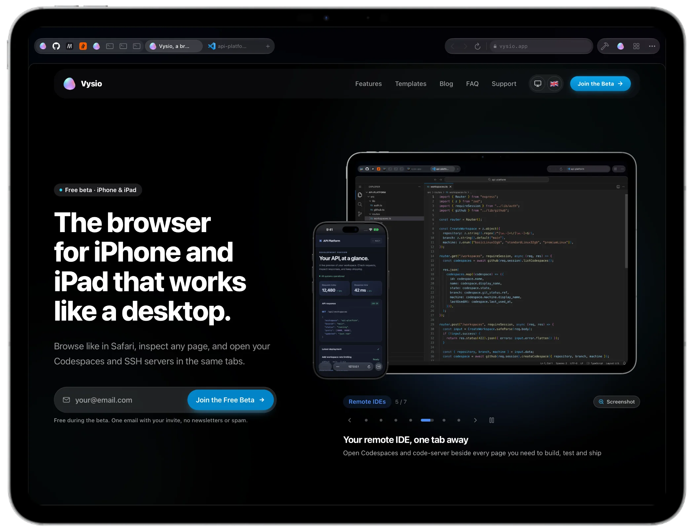
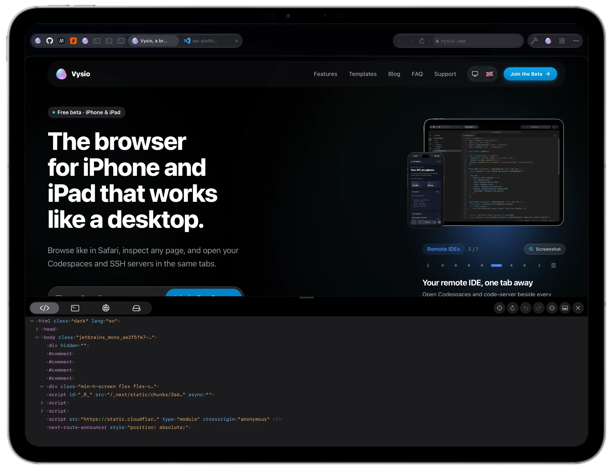
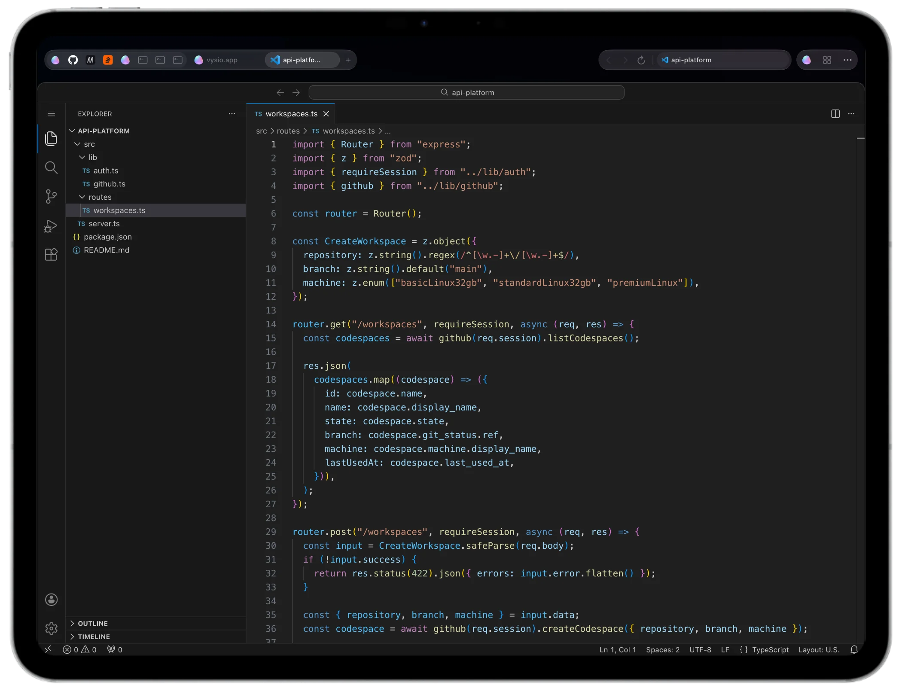

  

  # Vysio — Public Feedback, Issues & Discussions

  **A native, iPad-first developer browser for GitHub Codespaces and remote workspaces.**

  
  
  
  

   

  [📱 Website & Waitlist](https://vysio.app) • [🐛 Report a Bug](https://github.com/PierrePerrin/vysio.app.feedback/issues/new?template=bug_report.yml) • [✨ Suggest a Feature](https://github.com/PierrePerrin/vysio.app.feedback/discussions/new?category=ideas) • [💬 Discussions](https://github.com/PierrePerrin/vysio.app.feedback/discussions)

---

## 📸 Preview

  
  
  
  
<i>Current website screenshots: browsing, Web Inspector, and remote development.</i>

---

## 💡 What is Vysio?

Vysio combines a browser-first shell with GitHub Codespaces and remote development workspaces. The iPad is the primary target. An initial iPhone UI pass is in place, with device validation and remaining phone-specific work tracked in the [iPhone support checklist](https://github.com/PierrePerrin/vysio/blob/main/Docs/IPHONE_SUPPORT.md).

### 🌟 Current App Features

- 🌐 **Tabbed browser shell** — Websites, the workspace dashboard, and remote editors live side by side as tabs; the tab overview supports search and bulk actions.

- 🐙 **GitHub Codespaces** — Sign in with GitHub, browse repositories and Codespaces, create workspaces, and start, stop, rename, or delete them.

- 🔗 **Remote workspaces** — Open reachable HTTP or HTTPS URLs, including self-hosted `code-server` instances; use SSH terminal tabs and Codespace port previews.

- 🛠️ **Developer tools** — Use the built-in Web Inspector for DOM, styles, console, and network debugging, plus the omnibar for navigation and workspace commands.

- ⌨️ **iPad workflows** — Use hardware-keyboard shortcuts, trackpad input, fullscreen editing, and separate windows.

- 🔄 **Session continuity** — Keep workspace sessions available between launches and track favorites and recently opened workspaces.

- 🔐 **Privacy by design** — GitHub sign-in uses OAuth PKCE, tokens stay in Apple Keychain, and the app connects directly to GitHub without a Vysio backend.

---

## 🛠️ How to Share Feedback & Get Help

Use this repository to share feedback and help shape the future of Vysio:

- 🐛 **Bug Reports** → [Open a Bug Report](https://github.com/PierrePerrin/vysio.app.feedback/issues/new?template=bug_report.yml)
- ✨ **Feature Ideas** → [Start a feature discussion](https://github.com/PierrePerrin/vysio.app.feedback/discussions/new?category=ideas)
- 💬 **Questions, open-ended ideas, and general feedback** → [Join GitHub Discussions](https://github.com/PierrePerrin/vysio.app.feedback/discussions)

*Please search existing issues or discussions before posting.*

---

## 🗺️ Development Status

The app's current implementation status is maintained in the [Vysio feature backlog](https://github.com/PierrePerrin/vysio/blob/main/Docs/FEATURE_BACKLOG/README.md). iPhone-specific progress and outstanding device checks are tracked in the [iPhone support checklist](https://github.com/PierrePerrin/vysio/blob/main/Docs/IPHONE_SUPPORT.md).

Use [Issues](https://github.com/PierrePerrin/vysio.app.feedback/issues) for bug reports and [Discussions](https://github.com/PierrePerrin/vysio.app.feedback/discussions) for feature ideas, questions, and general feedback.

---

## 📚 Blog & Setup Guides

Read our latest articles and technical guides directly in this repository:

- 🚀 [**Introducing Vysio**](./blog/en/introducing-vysio.md) — Why we built a native iPad client for cloud IDEs.
- ⌨️ [**Magic Keyboard & iPad Codespaces Setup**](./blog/en/magic-keyboard-ipad-codespaces-setup.md) — How to solve browser shortcut collisions.
- 📱 [**GitHub Codespaces on iPad Guide**](./blog/en/github-codespaces-ipad-guide.md) — Step-by-step mobile cloud dev workflow.
- 💡 [**Why We Built Vysio**](./blog/en/why-we-built-vysio.md) — The story behind desktop-class iPad dev tools.

*(Available in English `blog/en/` and French `blog/fr/`)*

---

## ❓ FAQ & Troubleshooting

<b>How do I connect my self-hosted code-server?</b>

1. Ensure your `code-server` instance is reachable over **HTTPS**.
2. Copy the full URL (e.g. `https://dev.yourdomain.com`).
3. Open Vysio on iPhone or iPad and paste the workspace URL.
4. Authenticate using your server’s configured auth/token flow.

For private home-lab setups, we recommend using:
- [Tailscale](https://tailscale.com) (private mesh VPN)
- Cloudflare Tunnel (secure public ingress)

See the [self-hosting templates](https://github.com/PierrePerrin/vysio.app.templates) for ready-to-deploy setups.

<b>Are Magic Keyboard shortcuts supported?</b>

Yes. Vysio captures keyboard events natively on iPadOS, so common VS Code bindings such as `Cmd+Shift+P`, `Cmd+B`, and `Cmd+W` work reliably without browser interception.

<b>Codespaces won’t load or reconnect reliably. What should I check?</b>

- Confirm your GitHub account has access to Codespaces.
- Verify network connectivity and temporarily disable restrictive VPN/proxy rules.
- Ensure your organization policies permit Codespaces usage.
- Open a bug report and include reproduction steps, logs, or screenshots if available. For questions or general topics, use [Discussions](https://github.com/PierrePerrin/vysio.app.feedback/discussions).

---

## 🤝 Community Guidelines

Please read [CONTRIBUTING.md](./CONTRIBUTING.md) before opening issues. Keep issues and [discussions](https://github.com/PierrePerrin/vysio.app.feedback/discussions) respectful, constructive, and focused on improving Vysio.

---

## 📄 License

Content and documentation in this repository are licensed under the [MIT License](./LICENSE).
