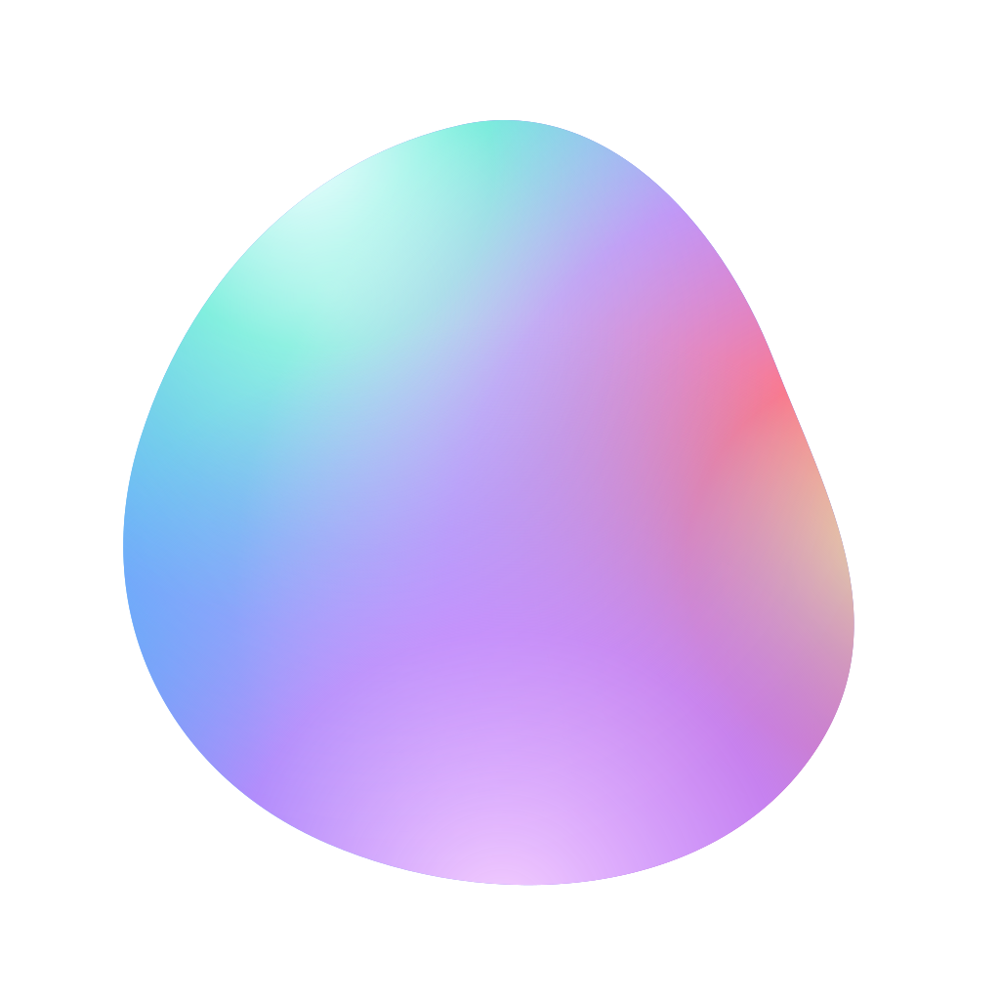
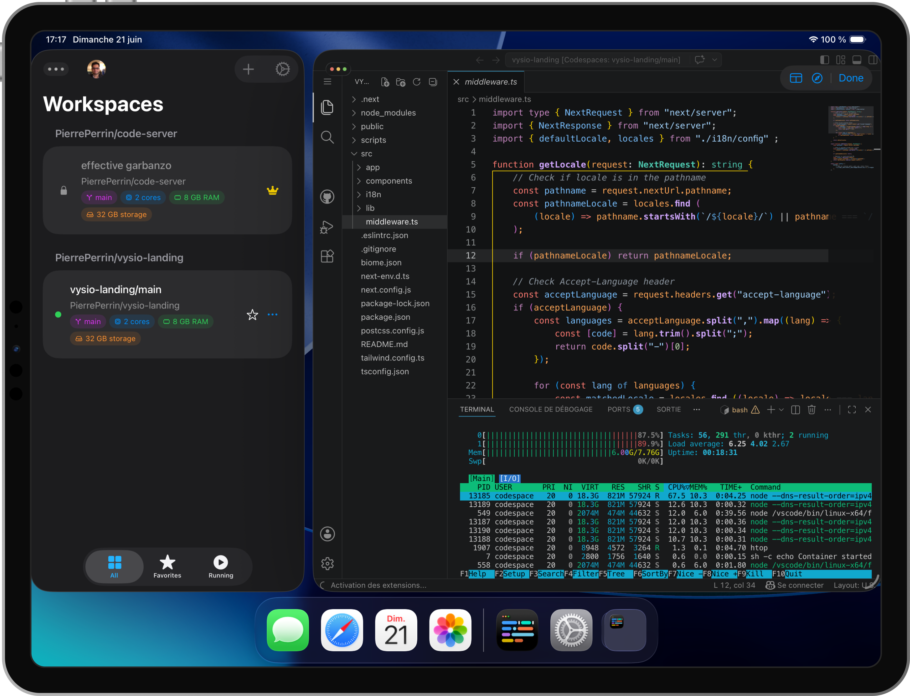

  

  # Vysio — Public Feedback & Issue Tracker

  **The developer browser for iPhone and iPad, with web tools and remote development built in.**

  
  
  
  

   

  [📱 Website & Waitlist](https://vysio.app) • [🐛 Report a Bug](https://github.com/PierrePerrin/vysio.app.feedback/issues/new?template=bug_report.yml) • [✨ Request Feature](https://github.com/PierrePerrin/vysio.app.feedback/issues/new?template=feature_request.yml)

---

## 📸 Preview

  
  
<i>Vysio brings browsing and remote development tools together on iPad.</i>

---

## 💡 What is Vysio?

Vysio is a native browser for iPhone and iPad that brings everyday browsing and developer tools together.

### 🌟 Current App Features

- 🌐 **Desktop-class browsing** — Use a native tab strip, private tabs, Reader, bookmarks, history, and downloads.

- 🛠️ **Built-in Web Inspector** — Inspect and edit the DOM and CSS, and debug with console and network tools.

- 🧭 **Omnibar & Agent** — Navigate to sites and workspaces, run browser actions, summarize pages, compare tabs, and search browsing history.

- 💻 **Codespaces, code-server & SSH** — Manage GitHub Codespaces, connect to self-hosted `code-server`, and use SSH terminal tabs.

- 🔐 **Keychain & app lock** — Keep GitHub credentials in Apple Keychain and lock the app with Face ID, Touch ID, or your device passcode.

- ⌨️ **iPad workflows & iCloud sync** — Use Magic Keyboard shortcuts and multi-window on iPad; sync bookmarks and history through iCloud.

---

## 🛠️ How to Report Bugs & Request Features

Use this repository to share feedback and help shape the future of Vysio:

- 🐛 **Bug Reports** → [Open a Bug Report](https://github.com/PierrePerrin/vysio.app.feedback/issues/new?template=bug_report.yml)
- ✨ **Feature Requests** → [Suggest a Feature](https://github.com/PierrePerrin/vysio.app.feedback/issues/new?template=feature_request.yml)
- 🗺️ **Public Roadmap** → Track upcoming milestones in our Issues & Discussions

*Please search existing issues before opening a new one to prevent duplicates.*

---

## 🗺️ Public Roadmap

Our public roadmap is structured into three key milestones:

### 🔹 Phase 1 — TestFlight Beta (Current)
- [x] Core iPad native client UX & Magic Keyboard support
- [x] GitHub authentication & Codespaces launcher
- [x] Remote URL support (`code-server`, Gitpod)
- [ ] Keyboard shortcut customization & reliability fixes
- [ ] Beta feedback & crash reporting loops

### 🔹 Phase 2 — App Store Launch
- [ ] Production hardening & performance optimization
- [ ] Onboarding diagnostics for self-hosted instances
- [ ] Security polish (biometric session lock & auto-timeout)
- [ ] App Store release

### 🔹 Phase 3 — Advanced Extensions
- [ ] Multi-workspace switching & QoL enhancements
- [ ] Deep-link integrations (`vysio://workspace/...`)
- [ ] Advanced remote configuration hooks & community power features

---

## 📚 Blog & Setup Guides

Read our latest articles and technical guides directly in this repository:

- 🚀 [**Introducing Vysio**](./blog/en/introducing-vysio.md) — Why we built a native iPad client for cloud IDEs.
- ⌨️ [**Magic Keyboard & iPad Codespaces Setup**](./blog/en/magic-keyboard-ipad-codespaces-setup.md) — How to solve browser shortcut collisions.
- 📱 [**GitHub Codespaces on iPad Guide**](./blog/en/github-codespaces-ipad-guide.md) — Step-by-step mobile cloud dev workflow.
- 💡 [**Why We Built Vysio**](./blog/en/why-we-built-vysio.md) — The story behind desktop-class iPad dev tools.

*(Available in English `blog/en/` and French `blog/fr/`)*

---

## ❓ FAQ & Troubleshooting

<b>How do I connect my self-hosted code-server?</b>

1. Ensure your `code-server` instance is reachable over **HTTPS**.
2. Copy the full URL (e.g. `https://dev.yourdomain.com`).
3. Open Vysio on iPhone or iPad and paste the workspace URL.
4. Authenticate using your server’s configured auth/token flow.

For private home-lab setups, we recommend using:
- [Tailscale](https://tailscale.com) (private mesh VPN)
- Cloudflare Tunnel (secure public ingress)

See the [self-hosting templates](https://github.com/PierrePerrin/vysio.app.templates) for ready-to-deploy setups.

<b>Are Magic Keyboard shortcuts supported?</b>

Yes. Vysio captures keyboard events natively on iPadOS, so common VS Code bindings such as `Cmd+Shift+P`, `Cmd+B`, and `Cmd+W` work reliably without browser interception.

<b>Codespaces won’t load or reconnect reliably. What should I check?</b>

- Confirm your GitHub account has access to Codespaces.
- Verify network connectivity and temporarily disable restrictive VPN/proxy rules.
- Ensure your organization policies permit Codespaces usage.
- Open a bug report with logs, screenshots, and reproduction steps.

---

## 🤝 Community Guidelines

Please read [CONTRIBUTING.md](./CONTRIBUTING.md) before opening issues. Keep discussions respectful, constructive, and focused on improving Vysio.

---

## 📄 License

Content and documentation in this repository are licensed under the [MIT License](./LICENSE).
